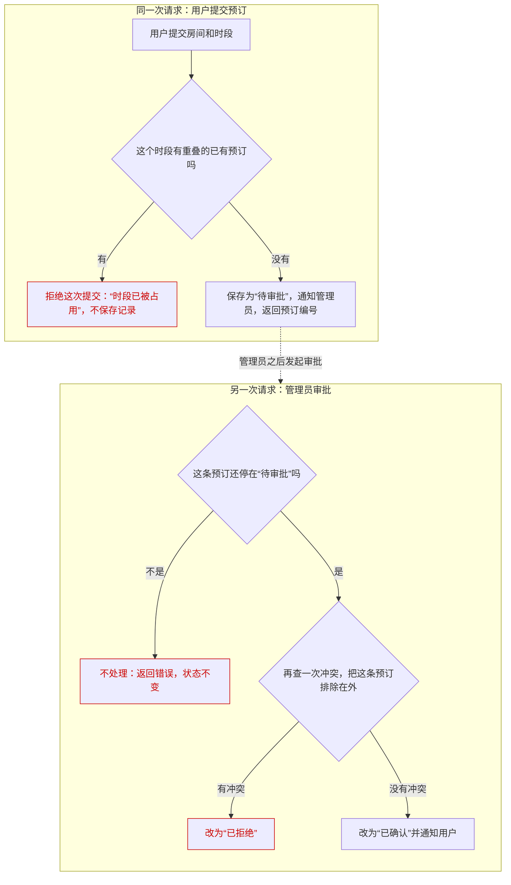

# 01 · 会议室预订：从提交到生效

> 本篇回答：一次预订从提交到生效要经过谁？冲突在哪里被拦住？审批前后，预订的状态怎样变化？
>
> 前置与关联：暂无其他篇需要先读；本篇用到的冲突检查就在文中就地讲清，只有它内部怎样判定（怎样算重叠、哪些状态的预订算占用）无法确认，原因在第二节说明。

用户想订一间会议室，系统要保证同一个房间的同一个时段只属于一个人。

## 一、全貌

用户要的结果，是某个房间的某个时段确定归自己。默认配置下，一条预订要经过两次请求才生效：用户提交一次，管理员审批一次。

参与方有提交预订的用户、审批预订的管理员，以及处理这两种请求的系统。把两次请求连起来的是预订记录：它带着房间、时段、用户和一个状态；用户提交后会拿到预订编号，系统通知管理员时也带着这个编号，管理员审批时凭它找到这条记录。

整个过程是这样：用户提交预订后，系统先检查时段冲突——有冲突就拒绝这次提交，不留下记录；没有冲突，就留下一条“待审批”的预订并通知管理员，用户的这次请求到此结束。管理员之后在另一次请求里审批：系统先确认这条预订还停在“待审批”（已经处理过的不会再处理一遍），再查一次冲突——没有冲突，预订才变为“已确认”并通知用户；查到冲突，这条预订被改为“已拒绝”。

| 叫法 | 在本文指什么 | 源码名 |
|---|---|---|
| 待审批 | 提交留下的状态：记录已存在，还要等管理员处理，预订尚未生效 | `PENDING_APPROVAL` |
| 已确认 | 管理员审批通过后的状态；到这一步预订才生效 | `CONFIRMED` |
| 已拒绝 | 审批时发现时段冲突，预订被否掉的状态 | `REJECTED` |
| 预订编号 | 提交成功后返回给用户、也随通知交给管理员的标识，审批凭它找到这条预订 | — |
| 审批开关 | 决定提交后是先停在“待审批”还是直接确认；默认打开 | `approval_required` |

下面用一个假设的例子（示意，不是真实数据）：张三提交一条预订，编号 B-1024，房间是 3 号会议室，时段是周三 14:00–15:00。提交后它停在“待审批”；管理员审批通过后，它才变为“已确认”。

## 二、提交预订

这一节跟着用户的那一次请求走：从提交房间和时段，到系统留下一条“待审批”的预订——或者当场拒绝这次提交。

1. 用户提交房间和时段。
2. 系统先查这个房间在这个时段有没有重叠的已有预订。有，就返回“时段已被占用”，不留下任何记录。
3. 没有重叠时，系统保存一条“待审批”的预订，通知管理员（通知里带着预订编号），并把预订编号返回给用户。

示例里，张三拿到 B-1024 时，这条预订刚刚存下，还没有生效。

第 2 步说的“重叠的已有预订”，有一点本篇讲不了：怎样算重叠、哪些状态的预订算“已有”，在本篇依据的源码文件里看不出来。提交和审批只是调用一段冲突检查的逻辑，再按它的结果处理；这段逻辑本身不在这个文件里。能确认的是两点：什么时候查，查到冲突怎么办。本篇只讲这两点。

提交时系统还会看一个审批开关（默认打开），上面讲的是开关打开时的过程。把它关掉时，没有冲突的提交会直接保存为“已确认”并通知用户，不再经过管理员。本篇其余部分都按默认配置讲。

## 三、管理员审批

这一节是另一次请求：管理员处理上一节留下的那条“待审批”的预订。产出是它被改为“已确认”（生效）或“已拒绝”。

1. 管理员凭预订编号发起审批。系统先找到这条预订，确认它还停在“待审批”；不是这个状态（比如已经审批过），这次审批不会被处理：系统直接返回错误，预订的状态保持不变。
2. 系统再查一次冲突，把这条预订自己排除在外——这样不管冲突检查怎样判定，它都不会被当成和自己冲突。
3. 没有冲突：改为“已确认”，并通知用户，预订从这时起生效。发现冲突：改为“已拒绝”；源码里这条分支没有通知用户这一步。

这里的“审批”，管理员只负责发起。在本篇依据的源码文件里，审批没有“同意”或“不同意”的选项，管理员也没有单独的“拒绝”操作；结果只由第 2 步的冲突检查决定：没有冲突就通过，查到冲突就改为“已拒绝”。

提交时已经查过一次，审批时还要再查，是因为两次请求之间隔着时间，这个时段的情况可能已经变了；再查一次，用的是审批那一刻的情况。这种变化具体怎样出现，取决于冲突检查内部怎样判定，也就是第二节说明的那一点未知。

示例里，管理员审批 B-1024 时没有查到冲突，它变为“已确认”，张三收到通知。

## 本篇小结

1. 一次预订从提交到生效要经过谁：用户提交一次，留下“待审批”的预订；管理员在另一次请求里审批，通过后预订才是“已确认”。
2. 冲突在哪里被拦住：提交时查一次，有冲突的提交不留下记录；审批时再查一次，查到冲突的预订被改为“已拒绝”。
3. 审批前后预订的状态怎样变化：只有停在“待审批”的预订会被审批；审批的结果是“已确认”或“已拒绝”，已经处理过的预订不会再被处理。

## 代码地图

| 文件或类 | 负责什么 |
|---|---|
| `source/booking.py` | 提交预订（`submit_booking`）和管理员审批（`approve_booking`） |
