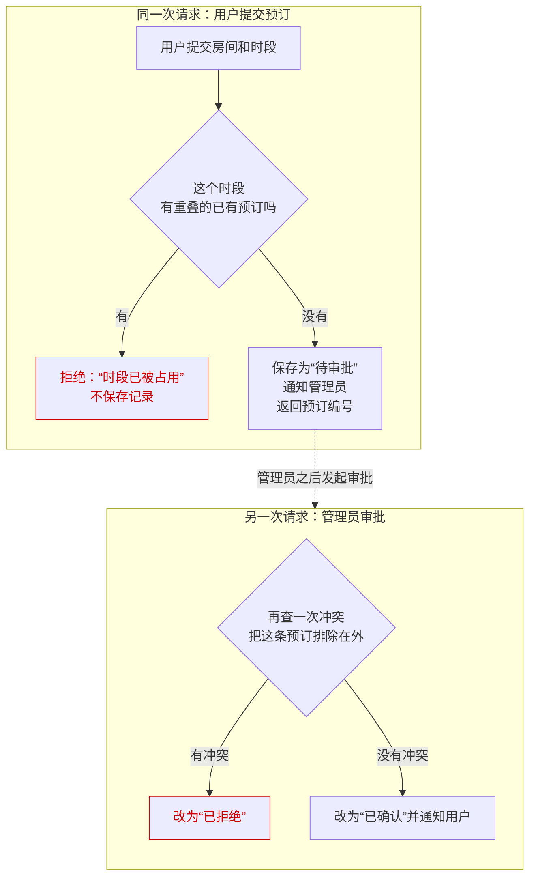

# 01 · 会议室预订：从提交到生效

> 本篇回答：一次预订从提交到生效要经过谁？冲突在哪里被拦住？
>
> 前置与关联：暂无其他篇需要先读；本篇用到的冲突检查就在文中就地讲清。

用户想订一间会议室，系统要保证同一个房间的同一个时段只属于一个人。

## 一、全貌

用户提交预订后，系统先检查时段冲突：有冲突就拒绝这次提交，不留下记录；没有冲突才继续往下走。默认配置下预订需要管理员审批：提交留下一条“待审批”的预订并通知管理员；管理员之后在另一次请求里审批，系统再查一次冲突，没有冲突，预订才变为“已确认”并通知用户；查到冲突，这条预订被改为“已拒绝”。

## 二、提交预订

用户提交房间和时段。系统先查这个房间在这个时段有没有已有预订：有，返回“时段已被占用”，不留下任何记录；没有，保存一条“待审批”的预订，通知管理员，并把预订编号返回给用户。

## 三、管理员审批

管理员在另一次请求里处理这条预订，凭预订编号找到它。系统再查一次冲突（排除它自己）：发现冲突就把它改为“已拒绝”；没有冲突就改为“已确认”，并通知用户。

## 本篇小结

预订先经过提交时的冲突检查，再经过管理员审批时的第二次冲突检查，通过后才生效。两处发现冲突的结果不同：提交时冲突，这次提交被拒绝、不留下记录；审批时冲突，预订被改为“已拒绝”。

## 代码地图

| 文件或类 | 负责什么 |
|---|---|
| `source/booking.py` | 提交与审批 |
