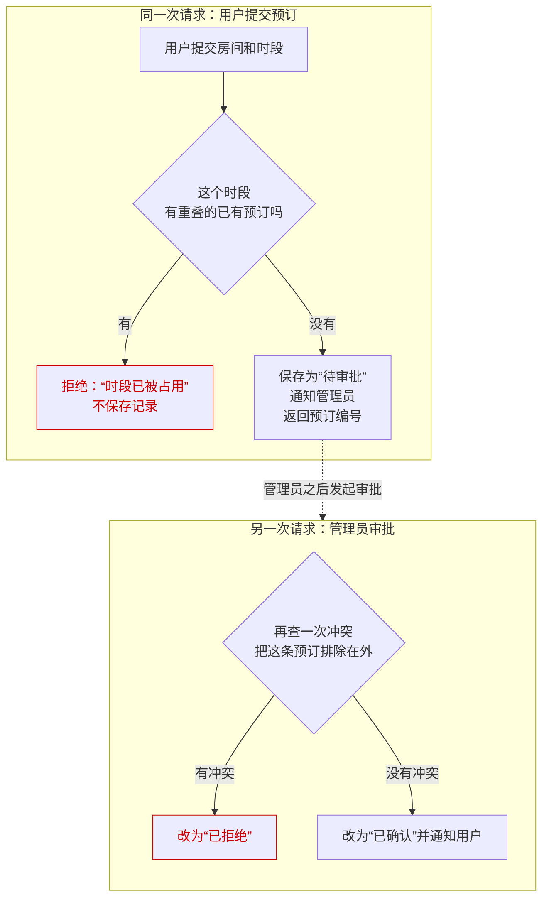

# 01 · 会议室预订：从提交到生效

> 本篇回答：提交之后，这条预订停在什么状态、什么时候才算订好？冲突在哪里被拦住？审批时为什么还要再查一次冲突？
>
> 前置与关联：暂无其他篇需要先读；本篇涉及的两次冲突检查和“待审批”“已确认”的区分都在文中就地讲清，只有一点无法确认——冲突检查按哪些状态判定占用，原因在第二节说明。

用户想订一间会议室，系统要保证同一个房间的同一个时段只属于一个人；默认配置下，提交之后还要等管理员在另一次请求里审批，预订才算订好。

## 一、全貌

用户要的结果，是某个房间的某个时段确定归自己。默认配置下，系统分两步给出这个结果：先受理提交，留下一条“待审批”的预订；再由管理员在另一次请求里审批，通过后才是“已确认”。

参与方有提交预订的用户、审批预订的管理员，以及处理请求的预订服务。把各环节连起来的对象是“预订记录”，它带着房间、时段、用户和状态；用户提交后会拿到预订编号，服务通知管理员时也带着这个编号，管理员审批时凭它找到这条记录。

默认配置下的完整过程是这样：用户提交房间和时段，预订服务先查这个房间在这个时段有没有重叠的已有预订——有冲突，就告诉用户“时段已被占用”，不保存任何记录；没有冲突，就保存一条“待审批”的预订，通知管理员来处理，并把预订编号返回给用户。到这里，用户的这次请求结束，预订还没有生效：拿到编号只表示提交被受理。管理员之后在另一次请求里审批：服务凭编号找到这条预订，确认它仍停在“待审批”，再查一次冲突（把这条预订排除在外）——没有冲突，就把它改为“已确认”并通知用户，预订从这时起生效；查到冲突，就把它改为“已拒绝”。同一条预订的提交和审批是两次不同的请求，中间隔着时间。

| 叫法 | 在本文指什么 | 源码名 |
|---|---|---|
| 待审批 | 提交留下的状态：记录已存在，还要等管理员处理，预订尚未生效 | `PENDING_APPROVAL` |
| 已确认 | 管理员审批通过后的状态；到这一步预订才生效 | `CONFIRMED` |
| 已拒绝 | 审批时发现时段冲突，预订被否掉的状态 | `REJECTED` |
| 预订编号 | 提交成功后返回给用户的标识，审批凭它找到这条预订 | — |
| 审批开关 | 决定提交后是先停在“待审批”还是直接确认；默认打开 | `approval_required` |

下面用一个假设的例子（示意，不是真实数据）：张三提交一条预订，编号 B-1024，房间是 3 号会议室，时段是周三 14:00–15:00。他拿到编号时，这条预订停在“待审批”；管理员审批通过后，它才变为“已确认”。

## 二、提交预订：留下“待审批”

这一节跟着默认配置下的第一次请求走：用户提交预订，产出是一条停在“待审批”的记录和一个返回给用户的预订编号。

1. 用户选好房间和时段，提交预订。
2. 预订服务先查这个房间在这个时段有没有重叠的已有预订。有，就告诉用户“时段已被占用”，不保存任何记录——检查发生在保存之前，被拦下的提交什么都不会留下。 哪些状态的预订算“已有”，这份源码看不出来：冲突检查是由调用方传进来的一段逻辑，源码里只有“什么时候调用它、查到冲突怎么办”，没有它的内部实现。本篇只讲能确认的这两点。
3. 没有冲突时，服务保存这条预订，状态写成“待审批”：记录已经存在，但预订还没有生效。随后通知管理员来处理（通知里带着预订编号），并把预订编号返回给用户；之后审批凭这个编号找到记录。

提交时服务还会看一个审批开关（默认打开）。本文讲的是开关打开时的行为：先停在“待审批”，等管理员。把开关关掉时，没有冲突的提交会直接保存为“已确认”并通知用户，预订在这一次请求里就完成，不需要管理员。

## 三、管理员审批：另一次请求里再查一次冲突

这一节是另一次请求，不在用户的提交里发生：管理员处理刚才那条“待审批”的预订。产出是它被改为“已确认”（生效）或“已拒绝”。

1. 管理员凭预订编号发起审批。服务先找到这条记录，确认它仍停在“待审批”——不是这个状态的预订（比如已经审批过），这次审批不会被处理：服务直接返回错误，预订的状态保持不变。
2. 服务再查一次冲突，这次把正在审批的这条预订排除在外——这样它不会被当成和自己冲突。
3. 没有冲突：改为“已确认”，并通知用户，预订从这时起生效；发现冲突：改为“已拒绝”。源码里“已拒绝”这条分支没有通知用户这一步。

为什么提交时查过了、审批还要再查？提交时的检查用的是提交那一刻的情况；从提交到审批隔了一段时间，这个时段的情况可能已经变了——别的预订可能先被确认。再查一次，是在生效前用最新情况核一遍，避免把两条重叠的预订先后都放过去。

“提交时没有冲突、审批时却有”具体在什么情况下出现，取决于冲突检查按哪些状态判定占用——这就是第二节说明的那一点未知。能确认的是两次检查各自的行为：提交时先查，冲突就不保存；审批时再查，并把正在审批的这条排除在外。

## 本篇小结

提交之后，这条预订停在“待审批”；用户拿到编号只表示提交被受理，要等管理员在另一次请求里审批通过、状态变为“已确认”，才算订好。冲突在两处被拦住：提交时先查一次，冲突的请求不保存；审批时再查一次（把这条预订排除在外），发现冲突就改为“已拒绝”。再查这一遍，是因为提交到审批之间时段的情况可能已经变了，要在生效前用最新情况核对。整条默认流程跨两次请求：用户提交一次，管理员审批一次。

## 代码地图

| 文件或类 | 负责什么 |
|---|---|
| `source/booking.py` | 提交预订（`submit_booking`）和管理员审批（`approve_booking`） |
