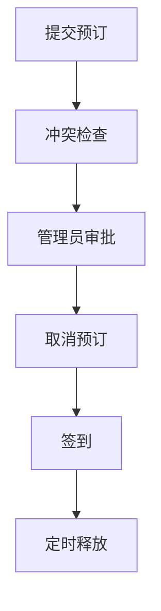

# 01 · 会议室预订

> 本篇回答：预订怎样避免时段冲突？管理员审批时为什么还要再查一次冲突？取消、签到和超时释放分别改变什么状态？

## 一、全貌

本篇讲会议室预订模块的六个步骤。

## 二、第一步：提交预订

请求体包含房间、时段和用户三个字段，状态枚举有待审批、已确认、已拒绝、已取消、已签到、已释放六个值，保存时由提交函数写入初始状态。

提交函数先检查时段冲突，冲突时返回 409。没有冲突时保存一条预订记录，把编号返回给用户。

## 三、第二步：冲突检查

409 表示“时段已被占用”。冲突检查用房间和时段去查已有预订，只要存在重叠就算冲突。

提交时检查一次，是为了不让两个人订到同一个房间的同一个时段。检查发生在保存之前，所以冲突的请求不会留下记录。

## 四、第三步：管理员审批

审批函数只处理“待审批”的预订，其他状态返回 409。

审批时还会再查一次冲突，并把正在审批的这条排除在外。因为从提交到审批隔了一段时间，这期间别的预订可能已经被确认；不再查一次，就可能批准出两条重叠的预订。再查发现冲突时，这条预订被改为“已拒绝”；没有冲突就改为“已确认”，并通知用户。

## 五、第四步：取消预订

只有本人能取消，别人取消返回 403。

取消只对“待审批”和“已确认”两种状态生效，其他状态返回 409。取消后状态改为“已取消”。

## 六、第五步：签到

签到只接受本人的“已确认”预订，并且必须已经到开始时间，否则返回 409。

签到成功后状态改为“已签到”。

## 七、第六步：定时释放

超时时间是 15 分钟。

定时任务每分钟运行一次，找出开始超过 15 分钟仍是“已确认”的预订，把它们改为“已释放”，让房间可以被别人使用。已签到的预订不会被释放，因为它的状态已经不是“已确认”。

## 本篇小结

提交时查冲突避免重复预订；审批时再查一次，是因为提交和审批之间别的预订可能已被确认；取消、签到、释放分别把状态改为已取消、已签到、已释放。

## 代码地图

| 文件或类 | 负责什么 |
|---|---|
| `source/booking.py` | 提交、审批、取消、签到与定时释放 |
