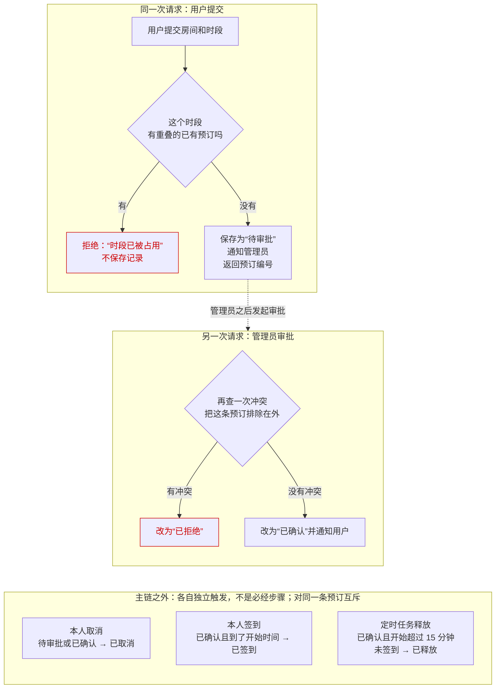

<!-- 骨架视图（skeleton）：篇首块 + 第一个一级章节全文 + 其余一至三级标题及其下第一段；不是完整正文。 -->

# 01 · 会议室预订

> 本篇回答：一条预订从提交到生效，中间经过谁、留下什么？冲突检查为什么在提交和审批里各做一次？取消、签到和释放分别由谁触发，把预订变成什么状态？
>
> 前置与关联：暂无其他篇需要先读；本篇用到的检查、状态和执行边界都在文中就地讲清。

用户想订一间会议室，系统要保证同一间房的同一个时段只属于一条预订。提交之后，系统先挡住重复的时段，再等管理员确认，这条预订才算订好；取消、签到和释放不在这条链上，是它可能走上的另外几条去向。

## 一、全貌

订会议室从用户提交房间和时段开始。默认配置下，这次提交不会立即让预订生效：系统只留下一条等待审批的记录，要由管理员审批通过，这个时段才算订好。

参与方有提交预订的用户（本文叫“本人”）、审批预订的管理员，以及一个每分钟运行一次的定时任务（它不由人触发）。把各环节连起来的是预订记录：记录带着房间、时段、发起用户和一个状态；用户提交后会拿到预订编号，之后的审批、取消和签到都凭编号找到这条记录，并检查它当时的状态。

一次完整的默认过程是这样：用户提交房间和时段，系统先拿这两样去查有没有重叠的已有预订——有，就拒绝这次提交，什么记录都不留下；没有，就保存一条状态为“待审批”的预订，通知管理员来处理，并把预订编号返回给用户。到这里，用户这一次请求结束，预订已经存在，但还没有生效。管理员随后在另一次请求里处理它：系统凭编号找到这条预订，确认它还在“待审批”，再查一次冲突（这次把这条预订本身排除在外）——查到冲突，就把它改为“已拒绝”；没有冲突，就改为“已确认”并通知用户，到这一刻，这个时段才算订好。在这条主链之外，这条预订还可能被取消、被签到或被释放：取消由本人在“待审批”或“已确认”时发起，签到由本人在到了开始时间之后发起（要求仍是“已确认”），释放由定时任务执行（对象是开始时间已过去超过 15 分钟、仍没签到的“已确认”预订）。这几件事各自独立触发、不按顺序发生，第四节展开。

| 叫法 | 在本文指什么 | 源码名 |
|---|---|---|
| 本人 | 提交这条预订的用户；取消和签到都要求由本人发起 | — |
| 预订编号 | 提交成功后返回给用户的标识，后续处理凭它找到这条预订 | — |
| 审批开关 | 决定提交后是先停在“待审批”还是直接确认；默认打开 | `approval_required` |
| 待审批 | 提交留下的初始状态：记录已存在，等管理员处理 | `PENDING_APPROVAL` |
| 已确认 | 管理员审批通过后的状态；到这一步预订才生效 | `CONFIRMED` |
| 已拒绝 | 审批时发现时段冲突，预订被否掉的状态 | `REJECTED` |
| 已取消 | 本人取消后的状态 | `CANCELLED` |
| 已签到 | 本人签到后的状态 | `CHECKED_IN` |
| 已释放 | 开始超过 15 分钟没人签到，被定时任务释放的状态 | `RELEASED` |

下面用一个假设的例子（示意，不是真实数据）串起全文：张三提交一条预订，编号 B-1024，房间是 3 号会议室，时段是周三 14:00–15:00。提交后它停在“待审批”；管理员审批通过后变为“已确认”；如果张三一直没签到，周三 14:15 之后它会被定时任务释放。

## 二、提交预订：先查冲突，留下“待审批”

主链从用户的一次请求开始。这一节跟着这次提交走完：从用户发出房间和时段，到系统留下一条能交给管理员的“待审批”记录——或者当场拒绝这次提交。

## 三、管理员审批：另一次请求，再查一次冲突

这一节讲的是另一次请求：管理员收到通知后，在自己的请求里处理刚才那条“待审批”的预订。产出是这条预订被改为“已确认”（生效）或“已拒绝”。

## 四、主链之外：取消、签到与释放

主链到这里走完。这一节讲三件不在链上的事：取消、签到和释放。它们都作用在前两节留下的那条预订记录上，但各自独立触发、没有先后关系，也不是每条预订都会遇到。对同一条预订，这几件事还互斥：发生其中一件，状态就变了，另外几件就不再轮到它——比如签到要求“已确认”，所以已取消的预订签不了到；已经签到的预订也不会再被释放。

### 4.1 本人取消

取消由本人发起，是一笔独立请求，不是审批之后的下一步：预订还停在“待审批”的时候，本人就可以取消它。可以取消的是“待审批”和“已确认”两种状态的预订。系统会拿发起请求的人和记录里的用户比对：不是同一个人，请求被拒绝；预订已经是别的状态（比如“已签到”“已释放”），请求也被拒绝。取消成功后，状态改为“已取消”。

### 4.2 本人签到

签到同样是本人发起的独立请求，到了会议的开始时间才会被接受：本人到场，把预订标记成已到场。签到检查三件事：发起人是不是记录里的用户、状态是不是仍是“已确认”、时间是不是已经到了开始时间。任何一件不满足，请求都会被拒绝。签到成功后，状态改为“已签到”。

### 4.3 定时任务释放

释放是唯一一件不由人发起的：一个定时任务每分钟运行一次，找出开始时间已经过去超过 15 分钟、状态仍是“已确认”的预订，把它们改为“已释放”，让房间可以被别人使用。15 分钟从开始时间起算，是留给本人的签到窗口；窗口过了还没签到，这条预订就被释放，之后再来签到，会因为状态已经不是“已确认”而被拒绝。已经签到的预订不会被释放——任务只处理仍是“已确认”的记录，而签到后状态已经是“已签到”。还有一个小边界：任务每分钟才跑一次，从“开始满 15 分钟”到“任务下一次运行”之间可能留出一小段间隙，这期间预订还停在“已确认”，签到仍然会被接受。

## 本篇小结

1. 一条预订从提交到生效经过谁、留下什么：用户提交后，系统先查冲突，留下一条“待审批”的预订和一个预订编号，交给管理员；管理员在另一次请求里审批，系统再查一次冲突，通过后把它改为“已确认”并通知用户，预订才生效。
2. 冲突为什么在提交和审批里各查一次：提交时挡住重复时段；审批时再查，是因为两次之间时段的情况可能已经变了，要在生效前用最新情况核一遍。
3. 取消、签到和释放由谁触发、把预订变成什么状态：取消由本人在“待审批”或“已确认”时发起，改为“已取消”；签到由本人在到了开始时间之后发起，改为“已签到”；释放由定时任务在开始超过 15 分钟仍未签到时执行，改为“已释放”。这几件事对同一条预订互斥。

## 代码地图
