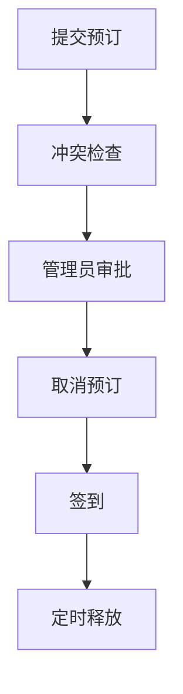

<!-- 骨架视图（skeleton）：篇首块 + 第一个一级章节全文 + 其余一至三级标题及其下第一段；不是完整正文。 -->

# 01 · 会议室预订

> 本篇回答：预订怎样避免时段冲突？管理员审批时为什么还要再查一次冲突？取消、签到和超时释放分别改变什么状态？

## 一、全貌

本篇讲会议室预订模块的六个步骤。

## 二、第一步：提交预订

请求体包含房间、时段和用户三个字段，状态枚举有待审批、已确认、已拒绝、已取消、已签到、已释放六个值，保存时由提交函数写入初始状态。

## 三、第二步：冲突检查

409 表示“时段已被占用”。冲突检查用房间和时段去查已有预订，只要存在重叠就算冲突。

## 四、第三步：管理员审批

审批函数只处理“待审批”的预订，其他状态返回 409。

## 五、第四步：取消预订

只有本人能取消，别人取消返回 403。

## 六、第五步：签到

签到只接受本人的“已确认”预订，并且必须已经到开始时间，否则返回 409。

## 七、第六步：定时释放

超时时间是 15 分钟。

## 本篇小结

提交时查冲突避免重复预订；审批时再查一次，是因为提交和审批之间别的预订可能已被确认；取消、签到、释放分别把状态改为已取消、已签到、已释放。

## 代码地图
