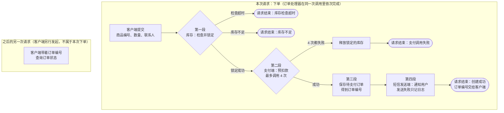

# 01 · 订单创建：接收请求并留下待支付订单

> 本篇回答：下单这次请求分哪几段，每段留下什么、谁接着处理？库存不足时怎样停止？支付失败怎样重试？短信失败是否影响订单？
>
> 前置与关联：本项目目前只有这一篇，没有需要先读的内容；支付失败后的重试也在本篇讲，没有另设专题篇。

用户提交一笔订单后，系统要在这一次请求里锁定库存、向支付端预扣款，并留下一条待支付订单，把订单编号交还给客户端。

## 一、全貌

用户提交商品编号、数量和联系人。请求办成的标志是客户端拿到订单编号，系统里多了一条待支付订单；库存或支付这两关过不去时，请求带着原因提前结束，不会留下订单。

这件事有五个参与方：

- 客户端：替用户发起下单请求，最后收到结果。
- 订单处理器：这次请求的执行者，下面每一步都由它发起。
- 库存：确认这批数量有没有货，有货就先锁定。
- 支付端：接受预扣款。
- 短信发送端：给联系人发通知短信。

把整个过程连起来的对象是订单和它的订单编号。订单在预扣款成功之后才保存，状态是待支付；订单编号在保存时产生，先交给短信发送端，再随结果交给客户端。

整件事在一次请求里分四段依次完成，前一段留下的东西是后一段的前提。客户端把商品编号、数量和联系人交给订单处理器。第一段，处理器请库存检查并锁定这批数量；检查超时或库存不足，请求就此结束，这时还没有向支付端发起任何调用。第二段，处理器请支付端预扣款；支付端不可用时等 200 毫秒再试，最多调用 4 次，4 次都失败就释放刚才锁定的库存并结束。第三段，预扣款成功后，处理器保存一条待支付订单，得到订单编号。第四段，处理器把联系人和订单编号交给短信发送端去通知用户，短信发不出去只记一条日志；然后把创建成功的结果和订单编号返回给客户端，这次请求到此结束。之后客户端想知道订单状态，要带着订单编号另外发起一次查询请求，它不属于这次下单。

本篇反复用到下面几个叫法，右列是它们在源码里的名字。

| 叫法 | 在本文指什么 | 源码名 |
|---|---|---|
| 订单处理器 | 接到下单请求后，按固定顺序锁定库存、预扣款、保存订单、发短信并返回结果的那段程序 | `create_order` |
| 锁定库存、释放库存 | 锁定是确认有货的同时占住这批数量；释放是把占住的数量还回去，只在预扣款最终失败时发生 | `lock_stock`、`release_stock` |
| 预扣款 | 处理器向支付端发起的调用；支付端接受了，流程才继续保存订单 | `pre_charge` |
| 待支付订单 | 预扣款成功后保存的订单记录，状态是待支付 | `save_order`，状态值 `pending` |

下面用一笔假设的订单把四段各自留下什么走一遍，人物、编号和数值都是示意。小周下单 2 件商品 A-100。假设库存充足；支付端第 1、2 次调用不可用，第 3 次成功；短信发送失败。

| 阶段 | 这一段结束时留下什么 | 谁接着处理 |
|---|---|---|
| 检查并锁定库存 | 2 件 A-100 被锁定 | 订单处理器，接着找支付端 |
| 预扣款 | 第 3 次调用成功，支付端接受了预扣款；前两次失败后各等了 200 毫秒 | 订单处理器，接着保存订单 |
| 保存待支付订单 | 一条待支付订单，编号记作 ORD-1 | 订单处理器，接着通知用户 |
| 通知用户并返回结果 | 短信没发出去，日志里多一条警告；客户端收到创建成功和 ORD-1 | 客户端（这次请求到此结束） |

## 二、检查并锁定库存

这是第一段。订单处理器此时只有客户端交来的商品编号、数量和联系人；这一段要产生的是被锁定的库存，库存不足或检查超时的请求会在这一段结束。

处理器把商品编号和数量交给库存，请它检查并锁定。处理器按这次调用的结果分三种情况处理：

- 锁定成功：进入下一段，处理器去找支付端。
- 库存不足：处理器返回 409 和“库存不足”，请求结束。
- 检查超时：处理器返回 503 和“库存检查超时”，请求结束。

库存这一关排在预扣款之前。后两种情况结束时，处理器还没有向支付端发起任何调用，所以没有需要撤销的预扣款，也没有订单。

示例里库存充足，2 件 A-100 被锁定，处理器进入下一段。

## 三、预扣款与失败重试

这是第二段。库存已经锁定，这一段要让支付端接受预扣款；支付端可能暂时不可用，所以处理器失败后会再试，但次数有上限。

处理器带着商品编号和数量调用支付端。支付端接受了，这一段就结束，处理器去保存订单。支付端不可用时，处理器等 200 毫秒再调用一次；这样最多调用 4 次，也就是第 1 次加上最多 3 次重试。每次失败之后做什么，取决于这是第几次调用，见下表；任何一次调用成功，都直接进入下一段。

| 第几次调用失败 | 处理器接着做什么 |
|---|---|
| 第 1、2、3 次 | 等 200 毫秒，再调用一次 |
| 第 4 次 | 释放上一段锁定的库存，返回 502 和“支付调用失败”，请求结束 |

这一段的两种结局：支付端接受了预扣款，处理器带着已锁定的库存进入下一段；4 次调用都失败，库存已经释放，请求以 502 结束，没有留下订单。

示例里第 1、2 次调用失败，处理器各等了 200 毫秒；第 3 次成功，用不到第 4 次。

## 四、保存待支付订单

这是第三段。支付端接受请求后，处理器才走到这里；这一段把订单记下来，订单编号也从这里产生。

处理器把订单保存为待支付状态，保存完成后得到订单编号。后面两件事都要用这个编号：发短信时带上它，返回结果时交给客户端。

订单是在预扣款成功之后才保存的。前面的三个失败出口——检查超时的 503、库存不足的 409、支付失败的 502——都发生在保存之前，所以都不会留下订单。

示例订单在这里保存下来，编号记作 ORD-1。

## 五、通知用户并返回结果

这是第四段，也是最后一段。订单已经保存，订单编号也有了；这一段先请短信发送端通知用户，再把结果交还客户端。

处理器把联系人和订单编号交给短信发送端，让用户知道订单已经受理。短信发送失败时，处理器只记一条警告日志，不重发，然后和发送成功时一样，返回创建成功（201）和订单编号。短信发没发出去不影响订单：订单已经保存，客户端照样拿到订单编号。

客户端收到结果，这次请求结束。之后它用订单编号查询订单状态，是另外发起的请求；本篇不讲那次请求怎样被处理。

示例里短信没有发出去，日志里多了一条警告，小周的客户端仍然收到创建成功和 ORD-1。

## 本篇小结

按篇首的四个问题逐一回答：

1. 下单这次请求分哪几段，每段留下什么、谁接着处理？分四段，都由订单处理器在同一次请求里依次完成：
   - 检查并锁定库存，留下被锁定的库存；
   - 预扣款，留下支付端接受的预扣款；
   - 保存待支付订单，留下订单和订单编号；
   - 通知用户并返回结果，把订单编号交给客户端。

   请求到这里结束，之后由客户端接手。客户端拿到订单编号，后续请求可以用它查询订单状态，那是它另外发起的请求。
2. 库存不足时怎样停止？库存不足会中断流程：第一段就返回 409，这时没有预扣款，也没有订单。库存检查超时同样在第一段结束，返回 503。
3. 支付失败怎样重试？支付调用有重试：支付端不可用时等 200 毫秒再调用，最多调用 4 次；4 次都失败，处理器释放锁定的库存并返回 502。
4. 短信失败是否影响订单？短信失败不改变已经创建的订单：处理器只记一条日志，仍然返回创建成功和订单编号。

## 代码地图

- `源码/order.py`：下单的调用顺序、重试与通知失败处理。
