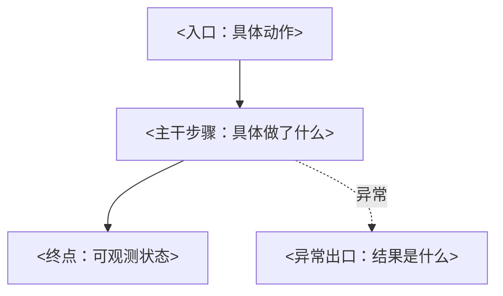

# NN · <对象 + 流程>

> 覆盖：<起点入口> → <终点：去哪查 / 查什么 / 看到什么算到达>
> 不覆盖：<内容>（见第 MM 篇）；<内容>（见 00 不覆盖表）

一句话主线：<用一个具体问题提出本篇要回答什么，例如“一笔订单，怎么在支付回调丢失、重复到达时仍然只记一次已支付？”。篇尾“本篇终点”要回答这个问题>

## 一、链路全貌

<一两句概述：这条链路做什么、得到什么结果、全篇追踪的那个具体对象是什么>

| 角色 / 术语 / 落点 | 在本篇指什么 | 源码名 |
|---|---|---|
| <直观叫法> | <一句话说明> | `<原始名称>` |

## 二、<第一大步：业务动作的概括>

<一两句概述本节做什么、结果是什么>

1. **<步骤动作>**：<做了什么：谁、在什么时候、对什么、结果如何>。<防的是什么：如果不做这一步，会在【具体情形】下出现【具体坏结果】>。

   **并发情况**：<紧跟它补充的这一步；块里的名词都在紧邻正文出现过>

2. **<下一步动作>**：<上一步的结果就是这一步的输入>……

## 三、<第二大步>

……

## 本篇终点与下一篇的接口

<回答篇首的问题。写明终点状态（与 `_衔接约定.md` 同名）、留下了什么、下一篇从哪里接手>

## 证据索引

### 源码直取

- <事实概括>：`<文件路径>#<方法或行号>`

### 借鉴 project-map，已核对

- <事实概括>：`<模块文件>#<节点 ID>`，核对位置 `<文件路径>#<方法或行号>`

### 借鉴 project-map，未核对（只作结构参考）

- <内容>：`<模块文件>#<节点 ID>`

<!-- 写作提示（成文时删除本注释）：
- 补充块标签只用：补充说明 / 版本差异 / 实现限制 / 并发情况 / 异常情况 / 测试证据 / 当前限制
- 推断句末标【推导】，缺证据标【未确认】；会改变主流程走向的不确定点写“当前限制”补充块
- 正文的每个事实都要在 _事实/NN.md 找得到条目；数字和术语与 _术语表.md 一致
- 主线段落删掉反引号内容后仍能读懂；每个一级节的重点最多 3 处加粗
-->
