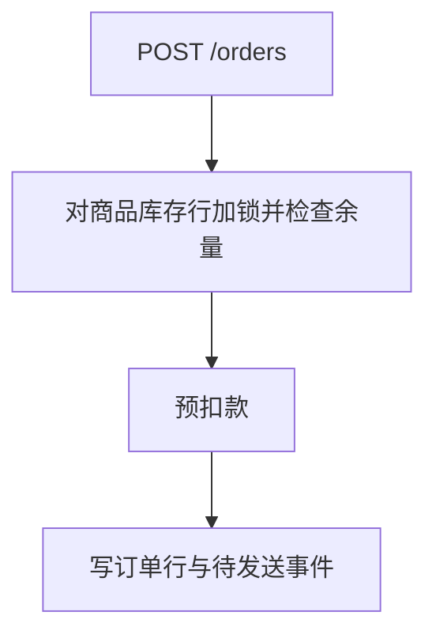

# 01 · 订单创建：从下单请求到待支付订单

> 覆盖：`POST /orders` → `orders` 表出现一行 `status=pending` 的订单
> 不覆盖：支付回调（见第 02 篇）

一句话主线：一笔订单，怎么在库存紧张、支付网关抖动的情况下，既不超卖，也不留下半成品？

## 一、链路全貌

## 二、受理下单请求

1. **接收请求**：下单处理函数（`create_order`）接收 `POST /orders`。

## 三、锁库存是防超卖的关键

1. **预扣款**：先调用支付网关预扣款（`pre_charge`），失败最多重试 5 次。
2. **锁库存**：然后对商品库存行加锁（`lock_stock`）并检查余量；余量不足返回 409。如果不先锁住库存，两个并发请求可能都看到库存 1，结果超卖一件。

   **异常情况**：库存服务超时后异常冒泡上去。

3. **写订单**：订单行写入，状态为 pending，随后写入 `outbox_event`。

## 四、通知用户

1. **发短信**：下单成功后发短信。即使短信服务故障，系统也一定会兜底通知到用户。

## 本篇终点与下一篇的接口

`orders` 表里留下一行 `status=pending` 的待支付订单；第 02 篇从支付回调接手这一行。

## 证据索引

### 源码直取

- 下单入口：`src/order/api.py#create_order`
